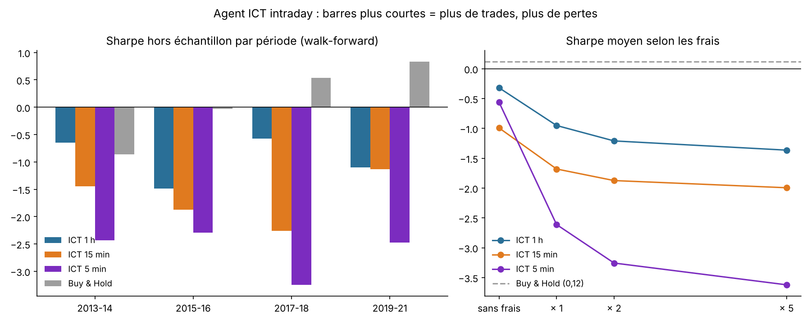

# Agent ICT intraday (barres de 1 h, 15 min et 5 min) : protocole et résultats

Commande : `uv run gold-agents ict-intraday -t 1h|15m|5m` (ou `make ict-intraday` pour les trois). Résultats dans `outputs/results/ict_intraday/<durée>/`. Code : `src/gold_agents/data/intraday.py`, `src/gold_agents/simulation/ict_intraday.py`, `src/gold_agents/evaluation/ict_intraday_report.py`.

## Données

`data/raw/intraday/XAU_1h_data.csv` : même dataset Kaggle que le fichier journalier, 125 206 barres d'une heure, du 11/06/2004 au 30/01/2026, SHA-256 `f143104b6ecd5634d82dcf2805711254c4d2e771cae84d742a21543791bca954`.
Les heures du fichier sont celles du serveur MT4 : **New York + 7 h**. Cela a été vérifié de deux façons : chaque semaine rouvre à 18 h (New York), et 98,8 % des clôtures journalières reconstruites sont égales à celles de `XAU_1d_data.csv`. Le jour de cotation commence à 18 h (New York).

## L'agent

Il suit le marché barre par barre et décide pendant la séance (heures de New York, achat seulement) :

1. Range asiatique : plus haut et plus bas de 20 h à minuit.
2. Sweep : après minuit, le prix passe sous le bas asiatique. Le creux devient le stop.
3. MSS : une clôture au-dessus du dernier sommet confirmé avant le sweep.
4. Entrée seulement si la barre suivante est en kill zone (Londres 2 h-5 h, New York 7 h-10 h), par un ordre valable une barre, écrit à la clôture de la barre :
   - `limit_fvg` : achat à cours limité dans le dernier FVG ;
   - `stop_pdh` : achat si la barre suivante casse le plus haut de la barre (réaction confirmée).
5. Objectif : haut asiatique, plus haut de la veille ou R fixe (`fixed_r`).
6. Sortie au stop, à l'objectif ou à 16 h. Si le stop et l'objectif tombent dans la même barre, on prend le pire cas. Jamais de position la nuit.

## Protocole

Grille de 24 réglages : entrée × swing (1, 2) × objectif (3) × R/R (1, 2). Walk-forward sur les périodes de la phase 6 : la période k est jugée avec le réglage choisi sur 1..k-1. Les données de 2022 et après ne sont jamais lues.
Hasard comparable : même nombre d'allers-retours, achat à l'ouverture d'une barre de kill zone tirée au hasard, vente à 16 h.

**Écart au plan, déclaré** : la grille a été élargie une fois, après un premier run (16 réglages, sans `fixed_r`), parce que l'objectif asiatique était presque toujours déjà atteint au moment du MSS (2 à 7 trades par période). Le walk-forward retenu est resté identique d'un run à l'autre.

## Résultats (run du 17/11/2026)

### Walk-forward (hors échantillon)

| Période | Réglage | Sharpe ICT | Sharpe B&H | Rendement ICT | Rendement B&H | Perte max ICT | Perte max B&H | Trades | Gagnants |
|---|---|---|---|---|---|---|---|---|---|
| 2013-2014 | limit_fvg, swing 2, objectif prev_day_high, R/R ≥ 2,00 | -0,64 | -0,86 | -0,7 % | -29,7 % | -0,8 % | -32,5 % | 6 | 33 % |
| 2015-2016 | limit_fvg, swing 1, objectif prev_day_high, R/R ≥ 2,00 | -1,48 | -0,03 | -3,3 % | -3,2 % | -3,3 % | -19,2 % | 14 | 14 % |
| 2017-2018 | stop_pdh, swing 2, objectif prev_day_high, R/R ≥ 2,00 | -0,58 | 0,54 | -0,8 % | +10,3 % | -1,0 % | -13,6 % | 10 | 40 % |
| 2019-2021 | stop_pdh, swing 2, objectif prev_day_high, R/R ≥ 2,00 | -1,10 | 0,83 | -2,4 % | +41,8 % | -2,4 % | -18,5 % | 14 | 14 % |

Moyenne : Sharpe ICT -0,95 contre 0,12 pour Buy & Hold et 0,21 pour SMA 20/50.

### Hasard (même nombre d'allers-retours, entrée en kill zone, sortie en fin de séance)

| Période | Trades | Sharpe ICT | Hasard médian | Hasard 95e centile | Hasard battu |
|---|---|---|---|---|---|
| 2 | 6 | -0,64 | -0,69 | 0,69 | 52 % |
| 3 | 14 | -1,48 | -0,78 | 0,48 | 7 % |
| 4 | 10 | -0,58 | -0,90 | 0,35 | 72 % |
| 5 | 14 | -1,10 | -0,59 | 0,41 | 12 % |

### Sensibilité aux frais (Sharpe moyen sur le walk-forward)

| Frais | ICT | Buy & Hold |
|---|---|---|
| × 0 | -0,32 | 0,12 |
| × 1 | -0,95 | 0,12 |
| × 2 | -1,21 | 0,12 |
| × 5 | -1,36 | 0,10 |

### Réglage choisi sur les 5 périodes (candidat au gel)

stop_pdh, swing 2, objectif prev_day_high, R/R ≥ 2,00

Attention : 24 réglages essayés. Le meilleur Sharpe moyen de la grille (0,03) est optimiste ; seul le walk-forward est hors échantillon.

### Ce que montre toute la grille (moyenne des 5 périodes, déjà vues)

| Réglages | Trades par an | Sharpe moyen | Taux de gain |
|---|---|---|---|
| Objectif à R fixe (8 réglages) | 26 à 85 | -1,85 à -3,16 | 21 à 30 % |
| Plus haut de la veille (8 réglages) | 5 à 29 | -0,97 à -2,36 | 16 à 21 % |
| Haut asiatique (8 réglages) | 0 à 2 | -0,84 à +0,03 | peu de trades |

Borne sur l'hypothèse du pire cas, pour `limit_fvg`, swing 2, objectif 1 R, sur 2011-2021 (292 trades) :

| Hypothèse dans la barre | Sans frais | Avec frais |
|---|---|---|
| Pire cas (stop d'abord) | -4,6 %, Sharpe -0,25, 45 % de gains | -32,8 %, Sharpe -1,84 |
| Meilleur cas (objectif d'abord) | +1,7 %, Sharpe 0,09, 51 % de gains | -28,5 %, Sharpe -1,57 |

## Lecture

- **Sans frais, les setups ICT en 1 h n'ont pas d'avantage** : avec un objectif de 1 R, ils gagnent 45 à 51 % du temps, soit le niveau d'une pièce de monnaie.
- **Avec des frais réalistes, ils perdent régulièrement.** Un risque de quelques dixièmes de pour cent par trade ne couvre pas 0,24 % de frais et de glissement par aller-retour. Plus l'agent trade, plus il perd.
- **Hors échantillon, le réglage choisi a un Sharpe moyen de -0,95**, contre 0,12 pour Buy & Hold. Il ne bat jamais le hasard au seuil de 95 %.
- Le seul avantage est le risque : l'agent n'est jamais investi la nuit, et sa perte maximale reste sous 3,5 %.

**Conclusion** : sur 2011-2021, les règles ICT intraday (range asiatique, sweep, MSS, FVG, kill zones) ne montrent aucun avantage mesurable sur l'or, même en données horaires et avec une exécution favorable. Le test 2022-2026 n'a pas été lu.

## 15 min et 5 min (run du 17/11/2026)

Données : `data/raw/intraday/XAU_15m_data.csv.gz` (494 235 barres) et `XAU_5m_data.csv.gz` (1 443 451 barres), même dataset Kaggle, du 11/06/2004 au 30/01/2026, heure serveur New York + 7 h. SHA-256 des CSV décompressés : `a48336b48c030bc407a5b53123fa46b328b74215bd7865f16890b3147a3d70b6` (15 min) et `9b0f8e72f8688da0d12a771b7365af2bb6f5484d62f4aa965734296e12bce3c2` (5 min).

Mêmes règles, même grille (entrée, objectif, R/R) et même protocole qu'en 1 h. Seule la taille des swings change, fixée avant de lire ces données : 2 ou 3 barres en 15 min, 3 ou 5 barres en 5 min. Le test 2022+ n'est pas lu.

| Barres | Sharpe moyen hors échantillon | Allers-retours (2013-2021) | Gagnants | Rendement cumulé | Sharpe sans frais | Périodes où le hasard est battu (moyenne) |
|---|---|---|---|---|---|---|
| 1 h | -0,95 | 22 | 23 % | -7,0 % | -0,32 | 36 % |
| 15 min | -1,68 | 46 | 11 % | -13,9 % | -0,99 | 8 % |
| 5 min | -2,61 | 156 | 17 % | -35,7 % | -0,56 | 3 % |
| Buy & Hold | 0,12 | | | | | |

Réglages choisis : en 15 min, `stop_pdh`, swing 3, objectif haut asiatique, R/R ≥ 2 (les 4 périodes) ; en 5 min, `limit_fvg`, swing 5, objectif haut asiatique, R/R ≥ 2 (les 4 périodes). Rapports complets : `outputs/results/ict_intraday/15m/` et `5m/`.

### Lecture

- **Des barres plus courtes n'aident pas.** Elles donnent plus de setups, donc plus de trades, et chaque trade paie les frais : le Sharpe passe de -0,95 (1 h) à -1,68 (15 min) puis -2,61 (5 min).
- **Même sans frais, aucune durée n'est positive** (-0,32, -0,99, -0,56). Le problème n'est donc pas seulement le coût : les setups n'ont pas d'avantage.
- **Avec un objectif à 2 R, il faudrait gagner plus d'un trade sur trois** pour être à l'équilibre sans frais. L'agent n'en gagne que 11 à 23 %.
- **En 15 et 5 min, l'agent fait pire que des entrées au hasard en kill zone** dans presque toutes les périodes : le sweep suivi d'un MSS sur ces barres ressemble plus à du bruit qu'à un retournement.

**Conclusion** : sur 2011-2021, ni le 1 h, ni le 15 min, ni le 5 min ne montrent d'avantage ICT mesurable sur l'or. Il n'y a pas de raison de passer au test 2022-2026 ni au direct avec ces règles.
